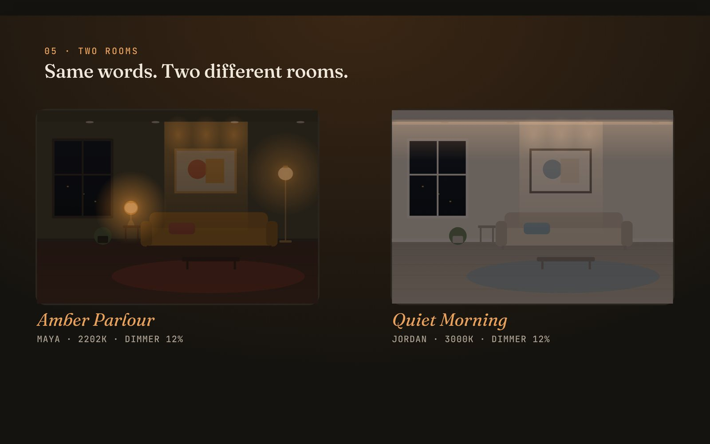

# Tastespec

**“Warm and modern” means a different room for every client.**

Paste what a client wrote. Tastespec reads what they love through Qloo's taste graph, finds the rooms people with that taste actually choose, and hands an interior or lighting designer a buildable spec, a room drawn from that spec, a hand-over document and a link for the client. Every line is traced to evidence.

> Built for the Qloo Agentic Hackathon ("Agents, but with taste"). MIT licensed.



*The 27-second film (`public/media/tastespec-film.webm`) is drawn live from two demo briefs on synthetic data.*

## Try it in two commands (Windows, macOS, Linux)

```bash
npm ci
npm run demo          # → http://localhost:3000, synthetic data, no keys needed
```

Needs Node.js 22.13+ (it uses Node's built-in SQLite, so there is nothing native to compile). Or `docker compose up`. For live Qloo evidence add `QLOO_API_KEY` to `.env.local` (see `.env.example`), then `npm run build && npm run serve`.

## The problem inside the problem

Taste agents assume the user's words carry their preferences. In design work they don't: *warm*, *modern*, *cozy* and *clean* each have several professional meanings ("warm" can mean 2700K light, oak and linen, a lived-in room, or a sociable one). The designer guesses and finds out at the walkthrough; a chatbot that only hears the words gives everyone who says them the same room. Clients can't describe rooms, but they can name the bands, shows, hotels and brands they love, and **Qloo knows which places people with that taste choose. Places are rooms.**

## What a designer does with it

1. **Paste the client's message.** The draft (words, loves, city, room, trade) fills in as you type, in your browser. With a Claude key, "Read with Claude" tidies it, and anything not in the message is dropped.
2. **Press Build.** The agent's graph narrows live on screen: what they said → what it could mean → the rooms their taste chooses (vs typical places in their city) → atmospheres → decisions → spec.
3. **Read the brief.** A room drawn from the spec, with the spec's own scenes on a dimmer (dim-to-warm included); one question if the evidence can't call it; every line with its basis, confidence and the literal reading it replaced.
4. **Go deeper.** Mainstream → Curated → Deep cut asks the same taste question among less popular places (both sides of the comparison), for reference rooms nobody else will have shown the client.
5. **Hand it over.** Direction, scenes and a zone-by-scene dimming table, palette, reference places, a buying list by category, an installer checklist, open risks, a client note. Print to PDF.
6. **Send the client their room.** A revocable link: they see the plan in plain words on their phone, answer the question, react to lines; you watch it land in the activity feed.
7. **See what moved it.** The influence map asks Qloo again with each of the client's loves left out and shows which lines each one decides ("Layering changes without Norah Jones"), plus how many lines survive dropping any single reference. Measured, not attributed by a model.
8. **Take the taste apart.** The Anatomy tab sends each love to Qloo on its own and compares the facets across domains: coherence, the conflicting pair and the "bridge" rooms both sides choose, a consensus core, bootstrap stability per line, flip distance, what music / screen / places alone would build, place-vs-tag corroboration and a niche index. Ten measurements, listed below.
9. **Walk into the room, then hand it on.** A 3D room lit by the spec (orbit, dim, warm), a 24-hour light clock, lumen-method fitting counts for a room size, a fixture schedule CSV, a spec JSON, a mood card PNG, spec history from the ledger, similar past clients, a duet merge for couples, a 3D taste space of all your briefs, and a ⌘K palette.
10. **Prove it.** Pathways traces any line back to the words that produced it; the ledger verifies in any browser; replay rebuilds the spec from stored evidence.

## Twenty things: ten measurements, ten hand-overs

**It measures** (Taste Anatomy, `src/lib/anatomy.ts`; each is a Qloo query or a resample of evidence already returned, ledgered, and never changes the spec):

1. **Facets.** Each love goes to Qloo alone (music, screen & people, places & brands), each scored against the same city baseline.
2. **Cross-domain agreement.** Cosine similarity of every pair of facets' atmosphere vectors, and a coherence score (the mean).
3. **Conflict.** The least-agreeing pair, named with what each pulls toward.
4. **Bridge rooms.** Qloo asked with both conflicting signals together; places that each facet also chose alone are marked "in both".
5. **Consensus core.** Places chosen by a majority of facets independently, and the atmosphere of just that core.
6. **Bootstrap stability.** 400 seeded resamples of the evidence; how often each line keeps its value, and the next most likely value.
7. **Flip distance.** How many of the strongest places must stop showing a line's driving atmosphere before the value changes.
8. **Domain-alone specs.** The spec built from each domain on its own, and how many domains agree per line.
9. **Two evidence channels.** Whether place evidence and Qloo's taste tags independently support each leading atmosphere.
10. **Niche index.** Jensen–Shannon divergence of the taste neighbourhood's atmosphere mix from the city's, plus mean popularity vs typical places.

**It hands you:** a 3D room lit by the spec · progressive depth (Mainstream → Curated → Deep cut) · a duet merge for two people (per line: agree, leans A/B, middle ground) · a 24-hour light clock · fitting quantities by the lumen method (an estimate, assumptions shown) · a fixture schedule CSV (labelled synthetic in demo mode, carrying the ledger head) and spec JSON · a revocable client link · spec history from the ledger · a 3D taste space and similar past clients · a mood card PNG.

## A specification you can verify, revise and export

Tastespec is a **cultural-intelligence-powered specification compiler**, not another AI interior designer. Open a brief's **Specification** tab (or the two-client challenge at the top of `/lab`):

- **Compile** the agent's result into a versioned package: typed values with units, the limits that bound each line, evidence ids, the rule that produced it, assumptions and unknowns (`docs/SPECIFICATION_COMPILER.md`).
- **Verify** it with a deterministic checker: seven dimensions, typed findings per line (`ERROR`, `WARNING`, `NEEDS_REVIEW`, `PASS`), repairs, and no certificate (`docs/SPEC_VERIFICATION.md`).
- **Challenge** it: change a reference, a requirement, or remove all Qloo evidence; the real agent reruns and a semantic diff shows what changed, what was preserved and why. Accept, reject, or return to the previous version.
- **Stress** it: remove one reference at a time and see which lines hang on a single one.
- **Export** it as a print-ready document (save as PDF), JSON or CSV. A failing specification exports only as a DRAFT.

- **Challenge** any line: *Why this? Why not that? Prove it. Repair it.* computed from the decision record; applying is explicit and ledgered. Review each line, then approve the version (`docs/DECISION_CHALLENGE.md`).

Competitor research and where this differs: `docs/COMPETITOR_INTELLIGENCE_2026.md`, `docs/DIFFERENTIATION_STRATEGY.md`.

## What the client writes down outranks the evidence

If the message contains a colour-temperature limit ("between 2700K and 3000K", "no cooler than 3000K"), a minimum CRI ("CRI of at least 95", "Ra 90 or above"), a dimming floor ("must dim to 5%", "dimming range 5% to 100%"), a dimming requirement, or a lux target ("about 250 lux"), it is parsed by fixed patterns (never by a model), shown as a **Hard limits** chip before you build, stored on the brief and applied inside the rulebook. Each is its own quantity and none is converted into another: lumens are noted but never turned into a room target without room and fitting data, and CRI is not presented as the whole of colour quality. Contradictory or impossible requirements (two different CRI minimums, a 0% dimming floor, a minimum above a maximum) are shown in red, stop the build, and are refused again on the server. They beat both Qloo evidence and the warm-word floor. A line it changes is marked `constraint` with a note saying what the rulebook would have said; the literal baseline, the "without Qloo" recompute, replay, the influence map and the duet merge all honour it, and a spec outside it fails validation. Tested by a 300-case property, an end-to-end run and the benchmark's `explicit_range` scenarios.

## How it stays honest

- **No memory, one graph.** The agent keeps nothing between clients; everything it knows about this one is the narrowing graph, stored with the brief.
- **Evidence or nothing.** Each atmosphere is a Beta-posterior lift of taste-matched places over the city baseline. No usable evidence → no personalisation: the brief says so and uses the literal reading. Qloo down → `UPSTREAM_UNAVAILABLE`, visibly.
- **Constraints the evidence can't override.** A client who said "warm" never gets light cooler than 3000K.
- **Models can't invent.** Spec values come only from a versioned rulebook. Claude's outputs are schema-checked and grounded: a draft keeps only what's in the message, prose is rejected if any number or name isn't in the brief's facts.
- **Everything recorded.** Every Qloo call, decision, model call and client action goes into a SHA-256 hash-chained ledger; every line is classified as evidence-supported, derived, client-stated or unsupported.
- **Synthetic is labelled.** Demo data says so on every screen, in the film, on the client page and in every brief.

## What the synthetic benchmark shows

Agreement with a synthetic oracle that applies the same rulebook to each scenario's known latent taste (64 scenarios, seeded world, not real clients or Qloo data; `reports/benchmark-summary.md`):

| System | Agreement (95% CI) | Warm-light violations |
|---|---|---|
| B0 literal words only | 0.41 [0.34, 0.48] | 0% |
| B2 Qloo evidence, no safeguards | 0.78 [0.73, 0.82] | 26% |
| **B3 Tastespec** | **0.88 [0.85, 0.91]** | **0%** |
| B4b without the city baseline | 0.74 [0.69, 0.80] | 0% |

Across four seeds B3 is 0.77–0.88 vs B0 0.41. **Not shown:** that the clarifying question improves accuracy (CIs span zero), or anything about real clients. The oracle shares our rulebook, so this measures taste recovery through the mapping, not design quality. Details: `docs/EVALUATION_METHODOLOGY.md`.

## Prove it yourself

| Command | What it does |
|---|---|
| `npm run demo` | Serve on synthetic data. Open `/lab` for the three-minute guided run (`docs/JUDGE_QUICKSTART.md`) |
| `npm run verify` | Typecheck, lint, tests, build, browser suite, benchmark |
| `npm run release:check` | Release audit: PASS / FAIL / BLOCKED / NOT RUN per check; live Qloo and a public URL are BLOCKED / NOT RUN unless configured, never passed |
| `QLOO_API_KEY=… npm run verify:qloo-live` | One-command live Qloo verification (exit 0 LIVE VERIFIED, 1 FAILED, 2 BLOCKED) |
| `npm run benchmark` | Synthetic benchmark (64 scenarios) |
| `/study`, `npm run study:report` | Blinded human preference study and its summary |

## Status, honestly

| | |
|---|---|
| Qloo integration | **NOT LIVE VERIFIED.** Built to the documented contract and contract-tested (auth, 429, malformed, timeout, cancellation, key redaction). No key and no network to Qloo in the build sandbox. `npm run verify:qloo-live` does it in one command (`docs/QLOO_LIVE_VERIFICATION.md`). |
| Tests | 200+ unit, property, adversarial and recovery tests (both database drivers included) and a 40-check browser suite (designer flow, client link, isolation, tampering, guided run, study, mobile, dark mode). |
| Human preference study | **ZERO HUMAN RESPONSES.** The blinded study at `/study` is built and tested; `reports/human-evaluation-summary.md` says NO HUMAN DATA COLLECTED. `docs/HUMAN_EVALUATION.md`. |
| LLM-only baseline (B1) | Not run: needs a model key. |
| Deployment | **NOT DEPLOYED.** Configuration (`vercel.json`, Docker, CI) and instructions are ready: `docs/DEPLOYMENT.md`. |

## Commands

| Command | What it runs |
|---|---|
| `npm run demo` | Build once, serve on synthetic data (cross-platform) |
| `npm run dev` / `npm run dev:demo` | Development server (live / synthetic) |
| `npm run serve` | Production server with your `.env` |
| `npm run typecheck` · `npm run lint` · `npm test` | TypeScript · ESLint · Vitest |
| `npm run build && npm run test:e2e` | Browser tests against the build (Playwright + Chromium) |
| `npm run benchmark` | Synthetic benchmark → `reports/` (`-- --seed=N`, `-- --with-llm`) |
| `npm run probe -- City` | Live Qloo probe (needs a key) |
| `npm run film` | Record the landing film → `public/media/` |
| `npm run verify` | Typecheck, lint, tests, build, e2e, benchmark |

## Documentation

`docs/ARCHITECTURE.md` · `docs/QLOO_INTEGRATION.md` · `docs/EVIDENCE_MODEL.md` · `docs/EVALUATION_METHODOLOGY.md` · `docs/SECURITY.md` · `docs/DEPLOYMENT.md` · `docs/ENGINEERING_AUDIT.md` · `docs/SUBMISSION.md`

## Limits

- Qloo affinities describe aggregate tastes of people who like the same things, not facts about the client.
- The fingerprint depends on the tags and keywords Qloo returns for places, which only a live probe can confirm.
- The room drawing illustrates the spec (light colour, sources, scenes); it is not a rendering of the client's room. Light levels are starting ranges, not a lighting calculation.
- Only public names of things a client loves and a city are sent to Qloo; the pasted message never is.
