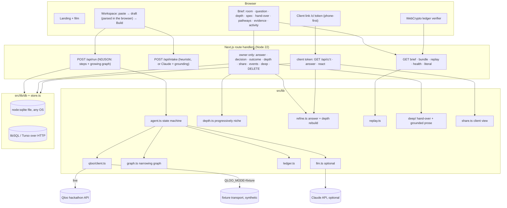
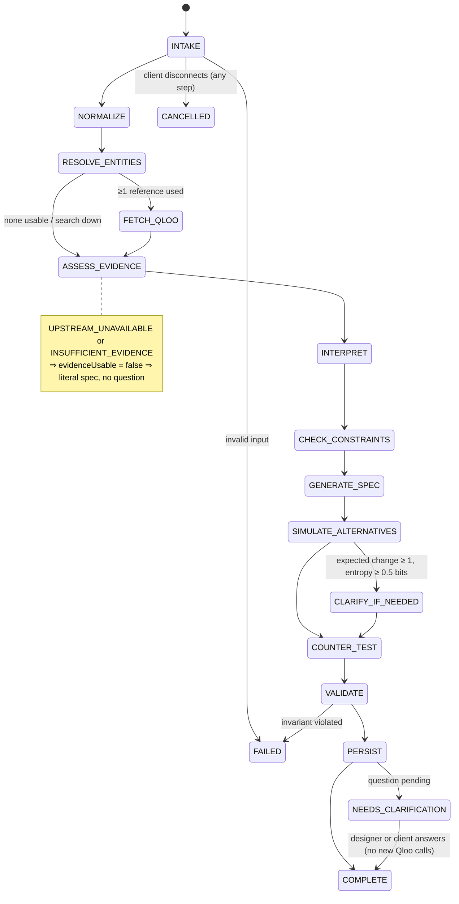
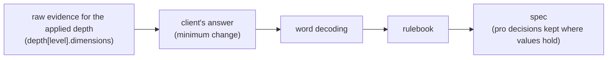

# Architecture

## Overview

## The agent remembers nothing; its working state is a graph

There is no conversation memory, no vector store and no profile of the client. Each run builds one graph that narrows left to right and is streamed to the browser as it grows (`{type: "graph"}` events), then rebuilt from the stored brief whenever it's shown:

| Column | Nodes | Narrowing |
|---|---|---|
| They said | the client's words and references | everything the client gave |
| Could mean | every professional reading of each word; each reference as resolved in Qloo (or abstained) | readings carry weights, abstentions are muted |
| Rooms chosen | the taste-matched places (top 16 by affinity) | of 40 per side |
| Atmospheres | nine kinds of room with measured lift | only those with a positive score stand out |
| Decisions | the reading each word resolves to, hard constraints, the question | a handful |
| Spec | the lines a pro builds | seven (lighting) or five (finishes) |

`tracePath` walks edges both ways, so any spec line can be lit back to the words and references that produced it (the Pathways tab), and any word forward to the lines it decided.

## Agent orchestration

Budgets per run: 55 s wall clock, 45 Qloo HTTP attempts, ≤3 attempts per request, backoff never past the deadline. Every step appends a `TraceStep`; every Qloo call, decision, model call and client input is a ledger entry.

FETCH records the geography it used (`scope`: inside the city, weighted toward it, or anywhere) so later steps compare like with like. When a model key is set, place tags the lexicon can't read are mapped onto atmospheres by Claude (`tagmap.ts`): cached for 30 days in the database, applied to taste-matched **and** baseline places alike, and labelled `mapped` in the evidence.

## After the run: one rebuild path

`refine.ts` is the only way a stored spec changes. The designer's or the client's answer, and switching depth, both go through it, so the order never matters and `replay.ts` can redo it from stored evidence and compare line by line (no Qloo or model calls).

## Progressively niche: depth levels

Level 0 is the main run. Levels 1 (Curated) and 2 (Deep cut) ask Qloo the same taste question restricted to places at or below a popularity cap — the median and 25th percentile of the main run's places, so the ladder adapts to whatever scale Qloo returns. The cap applies to **both** the taste-matched side and the city baseline, so the lift still compares like with like. If Qloo rejects `filter.popularity.max`, the layer fetches unfiltered pages and filters locally (`method: "client_filter"`), and says so. Layers with too few places are shown but marked thin or unusable; exploring never changes the spec until the designer applies a level.

## Influence map

`influence.ts` (on request, owner only) re-runs the taste-matched query once per resolved reference with that reference left out, keeping the geography, city baseline, taste tags and the client's answer fixed, and rebuilds the spec each time. A reference *decides* a line when its absence changes the value; its *push* is the score drop per atmosphere. Lines no single reference decides are counted as robust. Fragile lines feed the hand-over's open questions. Cost: one paged query per reference, all ledgered.

## Explicit constraints

`constraints.ts` parses a colour-temperature range from the client's message ("2700K–3000K", "no cooler than 3000K") by fixed patterns and bounds it to 1800–6500K. `BriefInput.cctRange` carries it; `cleanInput` re-validates anything from outside. `rulebooks/index.ts` clamps the colour-temperature line into the range (dim-to-warm ranges are narrowed, task-surface temperatures capped) after the evidence and the warm floor have spoken, and adds a constraint note. `buildSpec`, `literalSpec`, `specMenu`, `rankQuestions` and `planQuestion` all take the range, so the baseline, the question planner and replay see the same rule.

## Taste anatomy

`anatomy.ts` (on request, owner only, ~3 queries per reference + 1) asks Qloo once per resolved reference with only that reference, against the same city baseline, and compares the facets: pairwise cosine agreement and coherence; the least-agreeing pair and a bridge query carrying both; a consensus core (places chosen by a majority of facets); bootstrap stability (400 resamples, seeded, so it is reproducible); flip distance (greedy removal of the driving atmosphere among the strongest places); the spec each domain builds alone; place-vs-tag corroboration; and a Jensen–Shannon niche index. The result is stored on the brief and ledgered; the spec is not changed. Unstable lines and the conflict feed the hand-over's open risks.

## Studio tools

`studio.ts` holds pure functions behind the product tools: `quantityPlan` (lumen method, N = E·A / (Φ·UF·MF), UF 0.5, MF 0.8, labelled an estimate), `dayClock` (the scene, kelvin and level at each hour), `fixtureScheduleCsv` / `specJson` (exports carry the ledger head), `specHistory` (from the ledger), `tasteAxes` and `similarity` (taste space and similar clients, owner-scoped), and `mergeDuet` (two briefs → one room; mean of the measured atmospheres, both sets of hard constraints kept, no new Qloo calls). `Room3D.tsx` and `TasteSpace3D.tsx` use three.js, loaded only on the client, and fall back to a message without WebGL.

## The hand-over (deep brief)

`deep/build.ts` turns a brief into the document a designer hands on, with no network calls: direction name and summary, what each word means, scenes, a zone-by-scene programming table, zones with plans and rules of thumb, palette, reference places (from the applied depth), a buying list by category (no brands), an installer checklist, open risks, and a client note. Every item says what it rests on: a spec line, the evidence, the client, or a labelled rule of thumb.

`deep/prose.ts` optionally asks Claude for three pieces in parallel (direction, client note, one line per reference), each checked against the fact sheet: every number and every capitalised name must appear in the facts, within a word limit. Failures keep the template text and record why. Cached prose is keyed to a hash of the facts, so it goes stale when the brief changes.

## Sharing with the client

`POST /api/briefs/:id/share` returns a 144-bit token once; the database stores only its SHA-256. The client view (`share.ts`) leaves out the brief id (a permanent read link), the owner hash, the pasted message, the ledger and the trace, so revoking the token really ends access. The client can answer the question and react to lines (love / unsure / change + note); both are ledgered and appear in the designer's activity feed (`events` table, polled every few seconds while the tab is visible).

## Database

`src/lib/db` is a four-method interface (`exec`, `run`, `all`, `get`, plus `tx`) with two drivers:

- **SQLite** through Node's built-in `node:sqlite` (Node 22.13+): no native addon, no download, the same on every OS. WAL mode, incremental auto-vacuum.
- **libSQL / Turso** through `@libsql/client/http` (pure JavaScript, Hrana over HTTP) for serverless and multi-instance hosting.

Both run the same migrations and the same store code; the test suite runs the store suite against both, the libSQL one through the official client talking to an in-process Hrana server. Brief bodies are Brotli-compressed JSON; deletes cascade explicitly rather than relying on `foreign_keys`.

## Key modules

| Module | Responsibility |
|---|---|
| `agent.ts` | State machine, budgets, cancellation, terminal outcomes, invariants, answer/review/outcome updates |
| `intake.ts` | One pasted message → draft brief (heuristic parser; model output grounded in the message) |
| `qloo/client.ts`, `qloo/fixture.ts` | Typed adapter (pagination, retries, deadlines, request ids, hashing, ledgering); synthetic world for tests and demos |
| `resolve.ts`, `fingerprint.ts`, `words.ts` | Entity resolution; lexicon + Beta lift; evidence-weighted word decoding |
| `spec.ts`, `rulebooks/` | Versioned rulebook, constraints, per-line provenance, literal baseline, question planning |
| `graph.ts` | The narrowing graph and path tracing |
| `depth.ts`, `refine.ts`, `replay.ts` | Depth layers; the single rebuild path; deterministic replay |
| `render.ts` | Spec → room illustration parameters (kelvin colour, sources, scenes, dim-to-warm) |
| `deep/` | Hand-over document; grounded prose |
| `share.ts`, `store.ts`, `owner.ts`, `db/` | Client view and reactions; persistence; ownership; drivers and migrations |
| `evidence.ts`, `ledger.ts` | Line classification and citation checks; SHA-256 hash chain |

## UI

`src/app/(site)` holds the designer-facing pages under one layout (nav, demo-data banner, footer); `src/app/c/[token]` has its own minimal layout for clients; `src/app/film` renders the landing film full-screen for recording. Components are plain React with one stylesheet (`globals.css`: tokens for a light "paper" and a dark "after hours" theme, chart colours validated for contrast and colour-vision deficiency). The room illustration (`RoomRender.tsx`) is an SVG drawn from `render.ts`; the dimmer interpolates between the spec's own scenes.

## Evaluation pipeline

See `EVALUATION_METHODOLOGY.md` for what these numbers can and cannot show.
