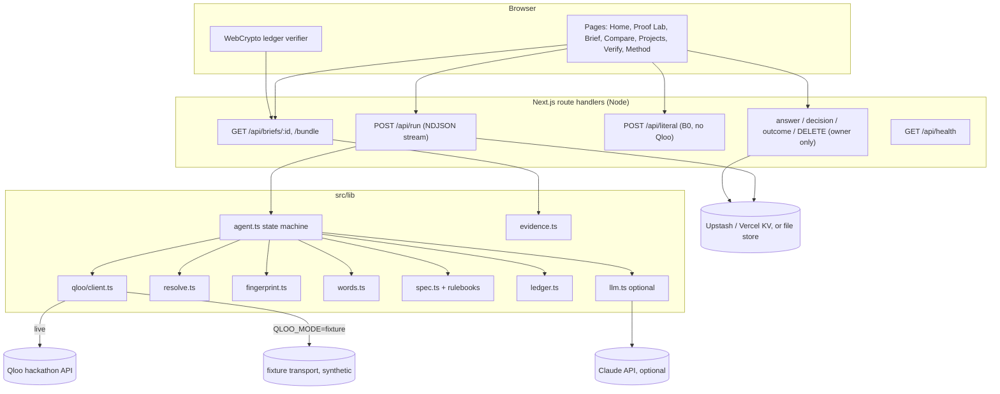
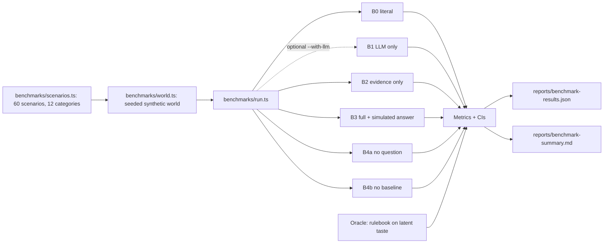

# Architecture

## Overview

## Agent orchestration

Budgets per run: 55 s wall clock, 45 Qloo HTTP attempts, ≤3 attempts per request, backoff never past the deadline. Every step appends a `TraceStep` (state, tool, decision, rationale, inputs, output, validation, ms, retries, ledger ids). The trace records decisions, not model reasoning.

The LLM-only counter-test starts in parallel at NORMALIZE and never sees Qloo data; it's joined at COUNTER_TEST with a timeout.

## Key modules

| Module | Responsibility |
|---|---|
| `agent.ts` | State machine, budgets, cancellation, terminal outcomes, invariant validation, answer/review/outcome updates |
| `qloo/client.ts` | Typed adapter: pagination, retries, deadlines, cancellation, request ids, response hashing, ledgering, typed errors |
| `resolve.ts` | Entity resolution: type hints, exact/near/abstain, collision flags, pinning, confidence |
| `fingerprint.ts` | Lexicon classification of places; Beta lift; evidence-gated scoring; minimum-change answer update |
| `words.ts` | Client-word readings; evidence-weighted decoding |
| `spec.ts`, `rulebooks/` | Versioned rulebook, constraints, provenance per line, literal baseline, question planning |
| `evidence.ts` | Line classification and citation cross-checks |
| `ledger.ts` | SHA-256 hash chain, verification (optionally against a committed head) |
| `store.ts`, `owner.ts` | Owner-scoped persistence (KV or file) |

## Evaluation pipeline

See `EVALUATION_METHODOLOGY.md` for what these numbers can and cannot show.
