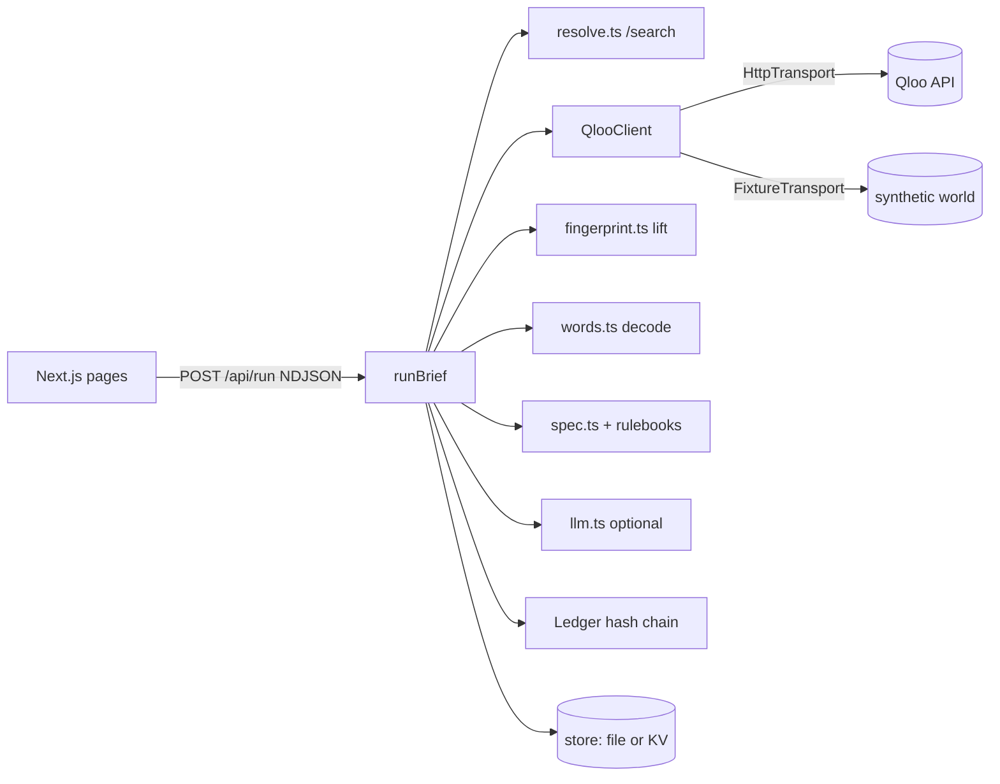

# Engineering audit

Audit of branch `claude/sweet-cori-f9x9j0` at commit `1cff3bc`, before the hardening pass. Every defect below was either reproduced by running code or read directly from source; reproduction notes are given where relevant.

## Verified starting state

| Check | Command | Result |
|---|---|---|
| Working tree | `git status` | clean, up to date with origin |
| Typecheck | `npx tsc --noEmit` | pass |
| Unit tests | `npx vitest run` | 24/24 pass (1 file) |
| Dependencies | `npm audit` | 0 vulnerabilities |
| Qloo reachability from the build sandbox | `curl https://hackathon.api.qloo.com/search` | **blocked** (egress proxy returns 403); no `QLOO_API_KEY` present |
| Qloo docs reachability | `docs.qloo.com`, `docs.qloo.com/mcp` | **blocked** from the sandbox |

Because the docs host is blocked, the API contract was taken from Qloo's own published sources: the hackathon kit (`github.com/qloo/qloo-hackathon-kit`) and the source of the official `@qloo/qloo-harness@0.1.26` npm package (read, never executed). See `docs/QLOO_INTEGRATION.md`.

## Architecture as found

Flow: intake → resolve loves (`/search`) → crowd places (`/v2/insights` place + signals + city, with two widening fallbacks) → baseline places (no signal) + taste tags (`urn:tag`) → classify places against lexicon → Beta lift per atmosphere → decode words → rulebook spec + literal column → question planner → optional LLM baseline and note → save.

## Fixtures, hardcoded values and placeholders

- `src/lib/qloo/fixture.ts`: synthetic world (36 fictional venues, 11 named loves with hand-set preferences). Active only when `QLOO_MODE=fixture`. The UI banner and the brief's `dataMode` label it. No code path silently switches from live to fixture (verified: `makeTransport` throws when the key is missing).
- `src/components/presets.ts`: demo client inputs (inputs only, no outputs).
- Hardcoded tuning constants: `MIN_TAGGED=12`, `TAKE=50`, word weight 0.6, score scale 1.5, tag-boost cap 0.3. None are presented as measured.
- No placeholder results or hardcoded success responses were found.

## Critical defects (P0)

1. **Upstream failure is disguised as thin evidence.** Reproduced: with every `/v2/insights` call returning 503, `runBrief` completes, saves a normal brief, keeps `dataMode` as `live`/`fixture`, and only warns "Thin evidence: only 0 tagged places". Violates "failure of the Qloo service must be visible".
2. **Confidence labels are not tied to evidence.** In the same reproduction, spec lines were labelled `medium` confidence with zero places behind them, because confidence also counts the rulebook margin, which the client's words alone can create.
3. **Unverified result size.** Every insights call requests `take=50` in one page. Qloo's official harness caps its tools at 20 results and paginates with a 1-indexed `page` parameter. If the hackathon API rejects or truncates `take=50`, defect 1 hides it.
4. **No access control.** `/projects` and `GET /api/briefs` list every visitor's briefs; the answer, decision and outcome endpoints accept writes from anyone who has a brief id. Brief ids carry ~41 bits of randomness.
5. **Non-durable persistence on serverless.** Without KV configured, briefs are written to `/tmp` on Vercel and disappear between instances. The UI says so on Projects but not elsewhere.

## Medium-priority defects (P1)

6. **Retry policy is weaker than Qloo's own client.** One retry after a fixed 800 ms; ignores `Retry-After`; no per-attempt timeout separate from the run; no overall deadline; requests aren't cancelled when the browser disconnects; no response-size cap; Qloo request ids aren't captured.
7. **Personalisation possible from taste tags alone.** The tag boost (up to +0.3) applies even when there is no place evidence, so a run with zero usable places can still move a spec line.
8. **Spec lines don't link to their sources.** Lines carry lift counts and venue names, but not the ledger entries (Qloo requests) that produced them, the rulebook version, or which constraints applied.
9. **The question planner ignores how likely each answer is.** It counts lines that differ between the two answers, so it can ask about a contrast the evidence has already settled.
10. **Model output isn't re-validated.** `llm.ts` trusts the JSON returned by structured outputs; values aren't re-checked against the menu after parsing.
11. **Fixture-mode copy claims "real places".** The question card says "Both are real places…" even in fixture mode.
12. **Rate limiting and the run budget are per-instance only.** Acceptable for a demo; must be documented.
13. **No lint script, no end-to-end test in the repo, no benchmark.** The browser check that was run earlier was a scratch script outside the repo.

## Already working (verified by tests or a browser run)

- Hash chain with tamper detection; serialised appends (concurrent appends can't fork the chain).
- Entity resolution with type hints, same-name collision flagging, a similarity floor, and pinning.
- Zero-evidence invariant: with no evidence, every spec line equals the literal reading (unit-tested).
- Warm-light guard: a client who used "warm" never gets light cooler than 3000K (unit-tested).
- Streaming timeline, Compare, Projects, Verify and Method pages; no console errors and no horizontal overflow at 390 px in the earlier browser run.

## Untested assumptions

- That Qloo place entities carry tags and/or `properties.keywords` with atmosphere-like vocabulary (the whole fingerprint depends on it). **Only a live probe can answer this.**
- That `filter.type=urn:tag` with only `signal.interests.entities` is accepted.
- That `filter.location.query` accepts a plain city name for places.
- That `/search` without `types` returns mixed entity types.

## Resolution (commit `04e5a8b` and later)

| # | Defect | Resolution | Verified by |
|---|---|---|---|
| 1 | Outage disguised as thin evidence | `UPSTREAM_UNAVAILABLE` / `INSUFFICIENT_EVIDENCE` terminal outcomes; literal fallback; DEGRADED badge | `tests/hardening.test.ts`, benchmark failure scenarios 4/4 |
| 2 | Confidence not tied to evidence | Evidence-gated confidence; fallback lines always low | property test P1 |
| 3 | `take=50` unverified | Pages of 20 with `page`; partial pages flagged | `hardening.test.ts` pagination |
| 4 | No access control | Owner-scoped list/write/delete; 96-bit ids; owner hash never returned | `tamper.test.ts`, e2e 403 checks |
| 5 | Non-durable storage | KV support; `durable` reported by health and Projects | `docs/DEPLOYMENT.md` (owner action) |
| 6 | Weak retry policy | Mirrors Qloo's client: 3 attempts, Retry-After, jitter, deadline, abort, 5 MB cap, request ids | `hardening.test.ts` |
| 7 | Tag-only personalisation | No scoring when evidence unusable | P1, `hardening.test.ts` sparse |
| 8 | Lines not linked to sources | `evidenceLedger`, `signalEntityIds`, `constraints`, `basis`, `rulebookVersion`, evidence report | `tamper.test.ts` citation checks |
| 9 | Question ignored answer likelihood | Expected-change + entropy criterion | `hardening.test.ts`, benchmark (22 → 9 questions) |
| 10 | Model JSON trusted | Re-validated against the menu / dimension ids | code review (`llm.ts`) |
| 11 | "Real places" copy in fixture mode | Mode-aware copy | e2e fixture checks |
| 12 | Per-instance limits | Documented in `docs/SECURITY.md` | n/a |
| 13 | No lint / e2e / benchmark | Added | `npm run lint`, `test:e2e`, `benchmark` |

Found during this pass by the benchmark and property tests, and fixed: input order changed results (signals now sorted); the answer update overshot and made answered briefs worse (now a minimum-change ordering constraint); that update wasn't idempotent near the −1 bound; long code strings overflowed the Method page on mobile.

## Execution plan (ordered)

1. Qloo adapter: pagination at ≤20 per page, Qloo-client retry policy with jitter and `Retry-After`, per-attempt timeout, run deadline, abort propagation, request-id capture, size cap, env validation, explicit `live` / `fixture` / `degraded` provenance. Probe script that writes a sanitised `reports/qloo-live-probe.json`.
2. Agent: explicit state machine with budgets and a decision trace; terminal outcomes `UPSTREAM_UNAVAILABLE` and `INSUFFICIENT_EVIDENCE` that fall back to the literal spec with no personalisation; evidence-gated confidence; per-line provenance (`basis`, ledger links, rulebook version, constraints); answer-probability-weighted question planning.
3. Benchmark harness on a seeded synthetic world, kept separate from live claims: B0–B4, 40+ scenarios, the metrics that can honestly be computed offline, and explicit "not measured" for those that need humans or a live key.
4. Security: owner-scoped briefs, protected writes, deletion, input limits, adversarial and tamper tests, secret scan.
5. Proof Lab, lint, end-to-end tests, documentation, release gates.
