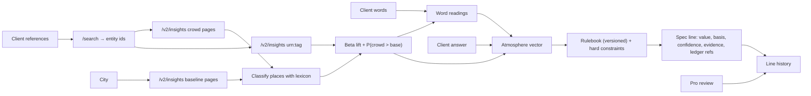

# Evidence model

## Source types

Every value in a brief comes from one of these, and they are never merged:

| Type | Example | Where recorded |
|---|---|---|
| `qloo_observed` | an entity id, a place's tags or keywords, an affinity number as returned | ledger `qloo_call.returned`, brief `crowdVenues` |
| `qloo_aggregate` | the ranking "people who like X choose these places" | ledger `qloo_call` entries cited by `SpecLine.evidenceLedger` |
| `app_mapping` | lexicon terms → atmospheres; rulebook → spec values | `RULEBOOK_VERSION`, `src/lib/dimensions.ts`, `src/lib/rulebooks/` |
| `llm` | counter-test picks, readings for unfamiliar words, the client note | ledger `llm_call` entries |
| `client` | the client's words and references, their answer, the pro's review | ledger `client_input` entries, `SpecLine.history` |

## Line classes

`src/lib/evidence.ts` classifies every spec line and cross-checks its citations against the ledger:

| Class | Meaning |
|---|---|
| `evidence_supported` | basis `qloo_evidence`, cites atmospheres with counts **and** Qloo requests that exist in the ledger and succeeded |
| `derived` | decided by the client's answer or a hard constraint |
| `client_stated` | the literal reading of the client's words (including the fallback when evidence was unavailable) |
| `unsupported` | claims evidence it can't back: a missing, nonexistent or failed request |

The report ships inside the evidence bundle (`/api/briefs/:id/bundle`, format `tastespec-evidence-bundle/2`).

## Provenance of a spec line

Each `SpecLine` carries: `basis`, `evidence[]` (atmosphere, crowd/base counts, lift, P, exemplar names and ids), `evidenceLedger[]` (Qloo request entries), `signalEntityIds[]`, `constraints[]`, `confidence`, `literalValue` and an append-only `history[]` of review actions with ledger links.

## Confidence

Confidence comes only from evidence:

- `high`: the strongest driving atmosphere has |2P−1| ≥ 0.8 and the rulebook margin is ≥ 0.3, or the line was decided by the client's answer or a constraint.
- `medium`: |2P−1| ≥ 0.5.
- `low`: otherwise, and **always** when there is no usable evidence.

## Authenticity vs truth

The ledger is a SHA-256 hash chain over canonical JSON. A verified chain proves the recorded entries haven't been edited, reordered or truncated relative to the head hash. It does **not** prove:

- that Qloo returned accurate data (only that this is what was recorded);
- that the head hash is the one originally issued. Compare it with a head you recorded when the brief was shared.

Each `qloo_call` entry stores the SHA-256 of the response body and Qloo's request id (when sent), so a disputed call can be matched against Qloo's own logs. Bodies themselves are not stored (hackathon terms; bulk data).

## Safety invariants and where they are enforced

| # | Invariant | Enforcement | Test |
|---|---|---|---|
| 1 | No usable evidence ⇒ no personalisation | `ASSESS_EVIDENCE` sets fallback; `computeDimensions(evidenceUsable=false)` zeroes scores; `buildSpec` uses literal; `validateBrief` rejects violations | `hardening.test.ts` outage/insufficient/sparse |
| 2 | Evidence can't override hard constraints | warm-light floor in rulebook; `validateBrief` | `engine.test.ts` warm floor; benchmark constraint metric |
| 3 | Unknown/ambiguous entities aren't silently known | similarity floor 0.75, abstain status, ambiguity flags + ledger decisions | `engine.test.ts` resolution; benchmark entity accuracy |
| 4 | Synthetic never shown as live | `dataMode` from transport; badges; per-call `transport` in ledger | `hardening.test.ts` fixture label |
| 5 | No fabricated Qloo data or results | probe writes only real output; benchmark labelled synthetic | review + `reports/` provenance |
| 6 | Qloo failure is visible and safe | `UPSTREAM_UNAVAILABLE`, degraded badge, warning, literal spec | `hardening.test.ts` |
| 7 | Affinity isn't presented as a fact about the person | copy in UI, bundle caveat, client note prompt | review |
| 8 | Review history is kept | append-only `SpecLine.history` + ledger entries, carried across re-scores | `hardening.test.ts` review history |

## Additions in this release

| # | Invariant | Enforcement | Test |
|---|---|---|---|
| 9 | A stored spec can be rebuilt from its own evidence | `refine.ts` is the only path that changes a spec (answer, depth); `replay.ts` recomputes the fingerprint from stored places, re-applies answer and depth, runs the rulebook and compares every line | `depth-replay.test.ts` (untouched, answered + deeper, and an edited line that replay names) |
| 10 | Depth layers compare like with like | the same popularity cap on crowd and baseline; same geography as the main run; local filtering is labelled | `depth-replay.test.ts` (every insights call in a layer carries the cap; fallback on a rejected parameter) |
| 11 | Model-mapped place terms are visible and symmetric | `tagmap.ts` maps only terms the lexicon missed, ≤2 valid atmospheres each, cached 30 days; matches carry `source: "mapped"`; applied to taste-matched and baseline places alike; ledgered | `depth-replay.test.ts` tag-mapper tests |
| 12 | Generated prose can't add facts | numbers and capitalised names must appear in the brief's fact sheet; otherwise the template text stays and the rejection is recorded | `deep.test.ts` grounding tests |
| 14 | Influence is measured, not attributed | leave-one-out queries to Qloo (same scope, baseline, taste tags and answer), ledgered; the spec itself is not changed | `depth-replay.test.ts` influence tests; e2e |
| 15 | Anatomy is measured and doesn't touch the spec | per-facet and bridge queries are ledgered; bootstrap is seeded; stored on `brief.anatomy` only | `anatomy.test.ts`; e2e |
| 16 | Exports say what they are | CSV/JSON carry the data mode (SYNTHETIC in demo) and the ledger head; quantities are labelled an estimate with assumptions | `studio.test.ts`; e2e |
| 17 | A range the client wrote down is never exceeded | parsed from the message by fixed patterns (`constraints.ts`), applied inside the rulebook so it outranks evidence and the warm floor; `validateBrief` rejects a spec outside it | `constraints.test.ts` (300-case property, replay, answering the question), `adversarial.test.ts`, e2e, benchmark `explicit_range` |
| 18 | Hostile Qloo payloads are absorbed or abstained on | tolerant parsers (2000 random shapes), bounded scores, injected text only ever lands in data fields; thin local coverage widens with a disclosed warning, none abstains | `adversarial.test.ts` |
| 19 | Each written number is its own quantity | CCT range, CRI minimum, dimming floor/need and lux target are parsed separately; lumens are noted, never converted; contradictory or impossible requirements stop the build at intake (client and server) | `constraints.test.ts` (parsing, conflicts, 300-case property over all four limits, intake gate, replay) |
| 20 | An upstream error cannot carry a credential to the browser | `redactSecrets` on every `QlooError`; auth, 429, timeout and malformed responses end in a labelled, actionable fallback, never fixtures | `recovery.test.ts` (a server that echoes the key back), `adversarial.test.ts` |
| 21 | Study responses are anonymous, blinded and tied to what was judged | random side and pair, no system names to the participant, case version hash, one response per session and case, withdrawal, off without durable storage | `study.test.ts`, e2e |
| 22 | A specification line can be re-verified without the agent that wrote it | compiled lines carry typed values, evidence ids, rule and a content hash; `verifySpec` checks limits, evidence, rule links, consistency and unknowns deterministically; a failing specification exports only as a DRAFT | `spec-engine.test.ts`, e2e |
| 23 | A revision never changes what the client wrote down, and says what it did change | `revise.ts` modifies one thing; `spec-diff.ts` separates value, evidence, constraint and wording changes; written limits are re-verified; a proposal replaces nothing until accepted; owner-scoped | `spec-engine.test.ts` (experiments A to E), `revisions.test.ts`, e2e |
| 13 | A client's link shows only the client view | no brief id, owner hash, pasted message, ledger or trace; revocation 404s | `depth-replay.test.ts`, e2e |

Client actions (answer, reactions) are ledgered as `client_input` with `via: "client"`, so the provenance of a line changed by the client's answer is visible in the bundle.
