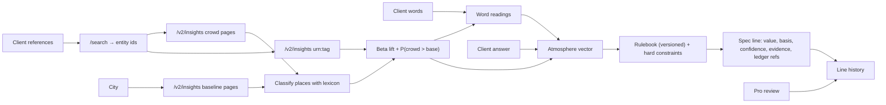

# Evidence model

## Source types

Every value in a brief comes from one of these, and they are never merged:

| Type | Example | Where recorded |
|---|---|---|
| `qloo_observed` | an entity id, a place's tags or keywords, an affinity number as returned | ledger `qloo_call.returned`, brief `crowdVenues` |
| `qloo_aggregate` | the ranking "people who like X choose these places" | ledger `qloo_call` entries cited by `SpecLine.evidenceLedger` |
| `app_mapping` | lexicon terms → atmospheres; rulebook → spec values | `RULEBOOK_VERSION`, `src/lib/dimensions.ts`, `src/lib/rulebooks/` |
| `llm` | counter-test picks, readings for unfamiliar words, the client note | ledger `llm_call` entries |
| `client` | the client's words and references, their answer, the pro's review | ledger `client_input` entries, `SpecLine.history` |

## Line classes

`src/lib/evidence.ts` classifies every spec line and cross-checks its citations against the ledger:

| Class | Meaning |
|---|---|
| `evidence_supported` | basis `qloo_evidence`, cites atmospheres with counts **and** Qloo requests that exist in the ledger and succeeded |
| `derived` | decided by the client's answer or a hard constraint |
| `client_stated` | the literal reading of the client's words (including the fallback when evidence was unavailable) |
| `unsupported` | claims evidence it can't back: a missing, nonexistent or failed request |

The report ships inside the evidence bundle (`/api/briefs/:id/bundle`, format `tastespec-evidence-bundle/2`).

## Provenance of a spec line

Each `SpecLine` carries: `basis`, `evidence[]` (atmosphere, crowd/base counts, lift, P, exemplar names and ids), `evidenceLedger[]` (Qloo request entries), `signalEntityIds[]`, `constraints[]`, `confidence`, `literalValue` and an append-only `history[]` of review actions with ledger links.

## Confidence

Confidence comes only from evidence:

- `high`: the strongest driving atmosphere has |2P−1| ≥ 0.8 and the rulebook margin is ≥ 0.3, or the line was decided by the client's answer or a constraint.
- `medium`: |2P−1| ≥ 0.5.
- `low`: otherwise, and **always** when there is no usable evidence.

## Authenticity vs truth

The ledger is a SHA-256 hash chain over canonical JSON. A verified chain proves the recorded entries haven't been edited, reordered or truncated relative to the head hash. It does **not** prove:

- that Qloo returned accurate data (only that this is what was recorded);
- that the head hash is the one originally issued. Compare it with a head you recorded when the brief was shared.

Each `qloo_call` entry stores the SHA-256 of the response body and Qloo's request id (when sent), so a disputed call can be matched against Qloo's own logs. Bodies themselves are not stored (hackathon terms; bulk data).

## Safety invariants and where they are enforced

| # | Invariant | Enforcement | Test |
|---|---|---|---|
| 1 | No usable evidence ⇒ no personalisation | `ASSESS_EVIDENCE` sets fallback; `computeDimensions(evidenceUsable=false)` zeroes scores; `buildSpec` uses literal; `validateBrief` rejects violations | `hardening.test.ts` outage/insufficient/sparse |
| 2 | Evidence can't override hard constraints | warm-light floor in rulebook; `validateBrief` | `engine.test.ts` warm floor; benchmark constraint metric |
| 3 | Unknown/ambiguous entities aren't silently known | similarity floor 0.75, abstain status, ambiguity flags + ledger decisions | `engine.test.ts` resolution; benchmark entity accuracy |
| 4 | Synthetic never shown as live | `dataMode` from transport; badges; per-call `transport` in ledger | `hardening.test.ts` fixture label |
| 5 | No fabricated Qloo data or results | probe writes only real output; benchmark labelled synthetic | review + `reports/` provenance |
| 6 | Qloo failure is visible and safe | `UPSTREAM_UNAVAILABLE`, degraded badge, warning, literal spec | `hardening.test.ts` |
| 7 | Affinity isn't presented as a fact about the person | copy in UI, bundle caveat, client note prompt | review |
| 8 | Review history is kept | append-only `SpecLine.history` + ledger entries, carried across re-scores | `hardening.test.ts` review history |
