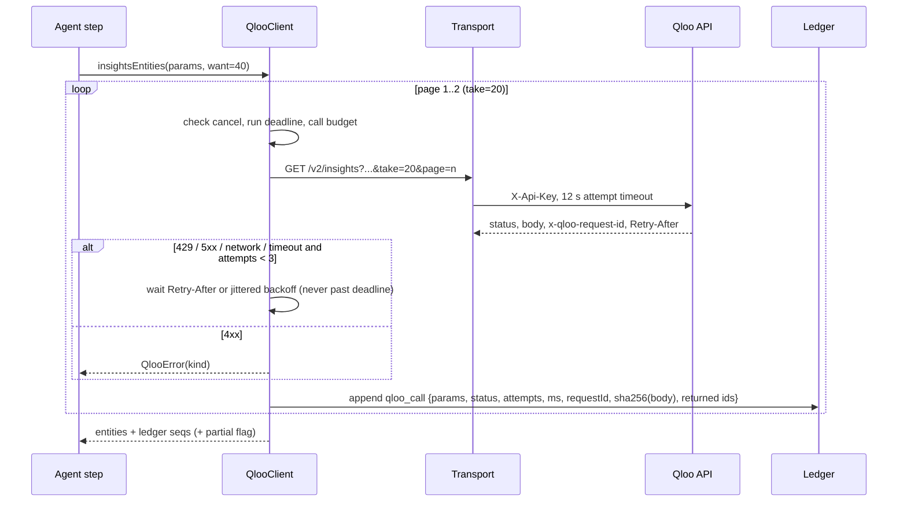

# Qloo integration

## Status

| Item | Status |
|---|---|
| Adapter against the documented contract | Implemented, unit-tested with scripted transports |
| Live calls against `hackathon.api.qloo.com` | **NOT VERIFIED.** The build sandbox has no Qloo key and its egress proxy blocks Qloo hosts (HTTP 403 on CONNECT). |
| `reports/qloo-live-probe.json` | Not present. It is only written by a real probe run; nothing is fabricated. |

To verify, run with a key (from a machine that can reach Qloo):

```bash
QLOO_API_KEY=... npm run probe -- Chicago
```

## Where the contract comes from

`docs.qloo.com` could not be fetched from the build sandbox, so the contract was taken from Qloo's own published code and kit:

- Qloo hackathon kit, `github.com/qloo/qloo-hackathon-kit` (`docs/API_ACCESS.md`, `docs/SAFE_USE.md`).
- The source of the official npm package `@qloo/qloo-harness@0.1.26`, which bundles Qloo's TypeScript client and its workflow tools. It was read, never executed.

Facts used, with where they come from:

| Fact | Source |
|---|---|
| Hackathon keys only work against `https://hackathon.api.qloo.com` | Hackathon developer guide |
| Auth is the `X-Api-Key` header, GET only | Developer guide; harness `QlooApiClient.request` |
| `/search?query=&types=&take=` | harness `resolveEntity` |
| `/v2/insights` requires `filter.type`; `signal.interests.entities`, `filter.location.query`, `signal.location.query`, `filter.tags`, `feature.explainability` | harness recommend / rank tools |
| `filter.type=urn:tag` with `signal.interests.entities` returns tags with affinity | harness `entity_tags` tool |
| Results are `results` (array) or `results.entities` / `results.tags`; affinity at `affinity` or `query.affinity` | harness `resultArray`, `compactEntity`, `compactTag` |
| Pagination is a 1-indexed `page` param; harness tools cap results at 20 | harness CLI `--page`, `QLOO_TOOL_MAX_RESULTS = 20` |
| Retry only 429/500/502/503/504, max 3 attempts, honour `Retry-After`, 5 MB body cap, request id in `x-qloo-request-id` | harness `packages/qloo-client-ts` |
| Qloo results are aggregate affinities, not facts about a person; don't send personal data | `SAFE_USE.md` |

## Request lifecycle



## Modes

| Mode | When | What the UI shows |
|---|---|---|
| `live` | `QLOO_API_KEY` set and valid-looking, `QLOO_MODE` not `fixture` | `LIVE · Qloo` badge |
| `fixture` | `QLOO_MODE=fixture` | `FIXTURE · synthetic` badge and a site-wide banner |
| degraded | Live, but some evidence failed (outage, partial pages, tag query failed) | `LIVE · DEGRADED` badge; outage → `UPSTREAM_UNAVAILABLE` status and literal fallback |

There is no silent switch from live to fixture: if the key is missing, runs fail with a configuration error.

## Queries per brief

1. `/search` per reference (≤10), with a type when hinted, retried without a type if the typed search is empty.
2. Crowd: `/v2/insights` `filter.type=urn:entity:place`, `signal.interests.entities=<sorted ids>`, `filter.location.query=<city>`, two pages of 20. If fewer than 12 tagged places come back, widen to `signal.location.query`, then to no location.
3. Baseline: the same scope with no taste signal, two pages of 20.
4. Taste tags: `filter.type=urn:tag`, same signals, `take=20`.

Typically 8–12 HTTP attempts per brief. Signals are sorted before querying so input order can't change results. The brief records which geography the evidence came from (`scope`: city, weighted, global).

## Queries when a designer goes deeper

"Curated" and "Deep cut" each repeat the crowd and baseline queries in the same geography as the main run, adding `filter.popularity.max` set to the median (Curated) or 25th percentile (Deep cut) of the main run's place popularity, at most 12 attempts per level. The same cap is applied to both sides so the lift still compares like with like.

- If Qloo answers `400` for the parameter, the layer re-fetches up to three unfiltered pages and keeps only places at or below the cap (`method: "client_filter"`), recording the decision in the ledger.
- If the city has too few such places, the layer moves to `signal.location.query` and says the evidence is weighted toward the city rather than inside it.
- Layers with fewer than 6 usable places per side are shown as unusable; under 12, as thin. Exploring never changes the spec until the designer applies the level.

The probe's check Q8 (`places:popularity-filter`) reports whether the live API accepts the parameter and whether every returned place is at or under the cap.

## What is and isn't claimed

- Tastespec reads Qloo's **tags and review keywords on places** through a published lexicon. It does not claim Qloo measures lighting or materials; the mapping from atmosphere to spec is Tastespec's own versioned rulebook.
- Affinity ranks describe people who like the same things, not the client. The UI and bundle say so.
- Untested assumptions, which the probe answers: whether hackathon place entities carry atmosphere-like tags/keywords, whether `urn:tag` insights accept entity signals alone, and whether a plain city name works in `filter.location.query`.
